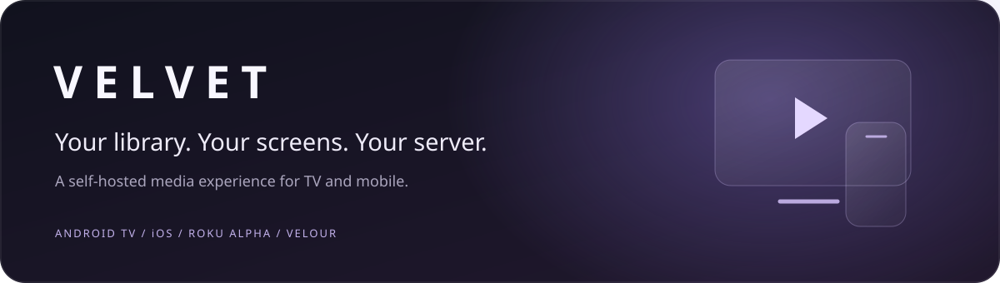
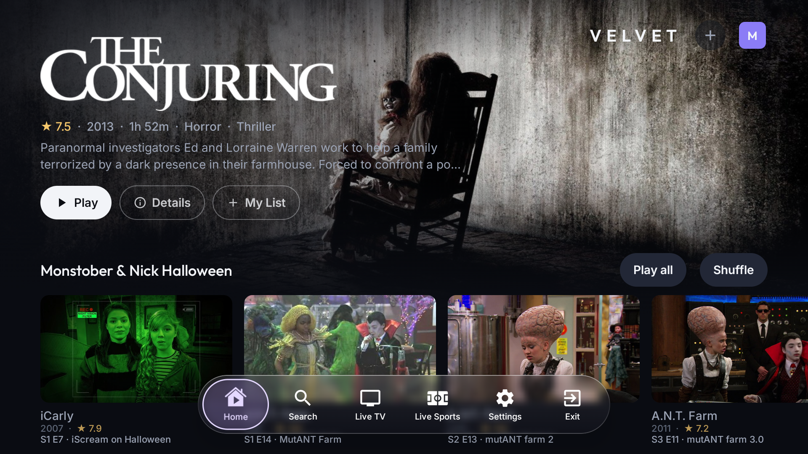
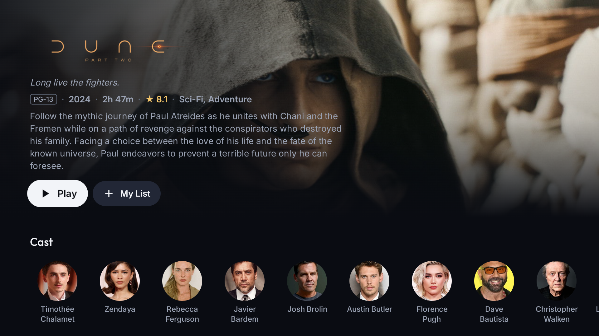
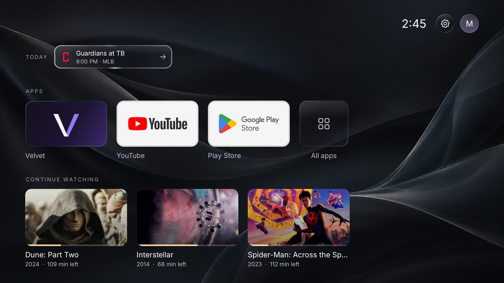
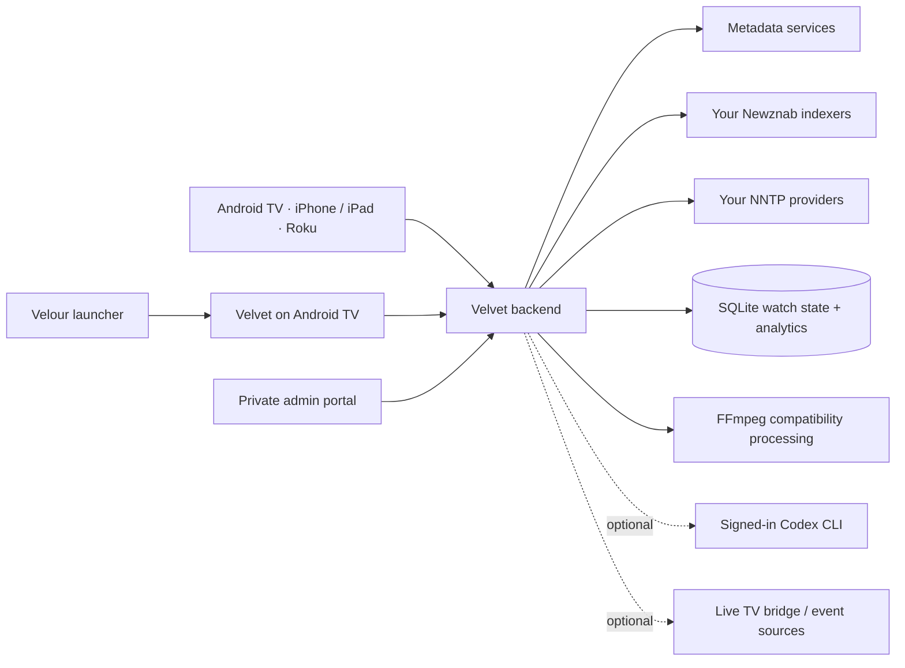

<p align="center"></p>

<p align="center">
  <a href="#get-started">Get started</a> ·
  <a href="#on-the-big-screen">Screenshots</a> ·
  <a href="#velour-your-velvet-home-screen">Velour</a> ·
  <a href="#the-apps">The apps</a> ·
  <a href="#how-it-works">How it works</a> ·
  <a href="SECURITY.md">Security</a> ·
  <a href="LICENSE">License</a>
</p>

Velvet is a self-hosted media system built around a simple idea: browsing, playback, and moving between screens should feel like one experience. A Rust backend connects your own services to native TV and mobile apps, with shared profiles, personal categories, playback handoff, and an admin portal that shows how your server is being used.

The interface puts artwork, readable type, responsive remote navigation, and translucent controls first. **Velour is the companion launcher for Velvet**: the recommended home screen for a Shield or Android TV, with your apps, Continue Watching, and favorite teams brought together in the same visual language.

This repository contains the backend, Android TV app, iPhone/iPad app, **Roku alpha**, and Velour launcher. It is a clean source release: bring your own server, credentials, subscriptions, and signing setup. No hosted account, media library, or preconfigured service access is included.

## On the big screen

**Velvet for Shield and Android TV.** Cinematic artwork, a floating glass dock, and episode collections with Play all and Shuffle.

[](docs/screenshots/velvet-tv-home.png)

**A closer look.** Full title artwork, an expandable description, and cast browsing.

[](docs/screenshots/velvet-tv-details.png)

*Actual app captures from a 1080p Android TV emulator, using a demonstration profile. Continue Watching entries shown below are staged. Artwork and third-party app marks belong to their respective owners. Click an image for full resolution.*

## Velour: your Velvet home screen

Start with a dark wallpaper, softly animated glass highlights, and a simple app grid. Your current Velvet profile's **Continue Watching** sits just below it. Select a movie or episode there to resume in Velvet, without browsing through the app first. The profile button opens Velvet's profile picker, so the home screen follows the person watching.

Choose your favorite **NBA, MLB, and NFL teams** in Velour's settings. Their games appear in the unobtrusive **Today** strip. With Live Sports configured in Velvet, selecting a card opens that game's player when a fresh matching event is available. When a match is not available yet, Velvet opens the relevant sports view so you can browse the available events. The schedule can show today's games independently of stream availability.

[](docs/screenshots/velour-home.png)

Velour and Velvet are designed to be used together. Build and install both with the **same signing certificate** to enable the protected profile, Continue Watching, and sports integration, then choose Velour as your device's Home application where supported. Velvet also works as a standalone app. [Set up the companion launcher →](launcher/README.md)

## The apps

| Component | Built with | What it does | Setup |
| --- | --- | --- | --- |
| **Velvet for Android TV** | Kotlin, Compose for TV, Media3, GeckoView | Remote-first browsing and playback, glass dock, profiles, category queues, stream/track controls, and playback handoff. Developed around NVIDIA Shield. | [Android guide](clients/android/README.md) |
| **Velvet for iPhone and iPad** | SwiftUI, VLCKit | Touch browsing and playback, iPad landscape support, shared watch state, categories, and Send to TV. | [iOS guide](clients/ios/README.md) |
| **Velvet for Roku — ALPHA** | BrightScript, SceneGraph | Native browsing, profiles, categories, player controls, live views, and reporting. Requires per-device developer-mode sideloading; hardware and feature differences remain. | [Roku guide and limitations](clients/roku/README.md) |
| **Velour — Velvet's companion launcher** | Kotlin, Compose | Android TV home screen with an app grid, wallpapers, Velvet resume shortcuts, game cards that open Live Sports, weather, and an ambient clock. | [Launcher guide](launcher/README.md) |
| **Velvet backend + admin** | Rust, Tokio, Axum, SQLite | Resolution and streaming, synchronization, compatibility processing, optional integrations, and private reporting. | [Server guide](backend/README.md) |

The apps share the same backend model, but playback support and visual effects depend on the platform. Roku remains alpha even when its automated checks pass. This repository does not provide a public Roku Channel Store listing, App Store/TestFlight invitation, or signed Android release.

## What you can do

### Browse once, keep watching anywhere

- Discover movies and shows, search, read details, browse cast and related titles, and maintain My List.
- Keep profiles and Continue Watching synchronized across configured devices.
- Send an eligible playing stream from mobile to an awake Shield with Velvet open, carrying the source and playback position across.
- Use the TV remote to move between content and the animated dock. Details pages retain normal Back navigation.

### Make a category, then press play

Create categories from natural language, with voice entry where the device supports it. A year or date range is optional.

| Ask for… | The category can contain… |
| --- | --- |
| “Cartoon Network shows from the late 2000s” | Whole shows |
| “Disney Halloween episodes” | Specific episodes across different shows |
| “Cozy winter movies” | Movies |
| “Star Wars movies in story order” | Movies in a requested sequence |

Play a category in order or shuffle it into a continuous queue. Category playback is kept out of Continue Watching, and saved categories can be deleted. The catalog also includes a curated Disney/Nickelodeon Halloween episode category. AI-generated selections depend on available metadata and may need checking, particularly for chronology or narrow episode themes.

AI categories are optional. The backend can invoke the official Codex CLI after you sign in with your own eligible account. Your account's access and usage limits apply; the project includes no shared account or unlimited AI entitlement. See [AI configuration](backend/README.md#optional-integrations).

### Stay in control of playback

- Choose a source, audio track, or subtitle; seek, move to the previous/next episode, and keep autoplay going.
- Recover from failed sources, prepare alternative playback paths, and block a troublesome release group for an individual show.
- Use backend compatibility processing for formats a client cannot play directly, including mobile audio conversion when needed. Capable TV clients can retain the original audio path; actual passthrough depends on the device, player, and sound system.
- Use intro skipping where detection data is available.

### Add live sources when you want them

Live TV and Live Sports are separate optional sections. A configured channel bridge supplies Live TV and supported guide mappings supply listings. An external event adapter supplies sports discovery and playback options. These integrations default to off and depend on your configured upstream services, account access, and client capabilities. The backend does not itself grant channels or remove provider restrictions.

### Understand your server

The private admin portal brings viewing activity and server capacity together:

- Playback time and daily averages, split between movies, television, live TV, and live sports.
- Profile, device, and title breakdowns, active sessions, and CSV exports.
- Provider connection limits, busy/free capacity, queues, traffic, and errors.
- Startup, buffering, source switches, and other playback-quality measurements.
- CPU, memory, and disk visibility, with retained analytics for the last 90 days.

Reports start when compatible clients send measured playback events. Existing watch progress is not retroactively converted into viewing history. Provider headroom reflects this backend's configured limits and usage; it cannot see connections used by separate downloaders on the same account. Admin access has its own private key, separate from the client token. [Admin setup →](backend/README.md#admin-portal)

## How it works



For on-demand Usenet playback, Velvet searches your configured indexers, resolves a release, retrieves the required articles through pooled NNTP connections, and serves a seekable HTTP stream. The client chooses and plays a compatible source. The backend also exposes a Stremio-compatible resolver, handles sync and handoff, and supplies audio/remux paths when required. It is designed around streaming on demand; it is not a bundled media collection.

Metadata and artwork are loaded at runtime. Your provider credentials and TMDB key stay in the backend's private configuration. Updated clients send metadata requests through the backend, so rotating its key does not require changing device settings. Watch state and analytics live on your server. Optional integrations contact the services you enable. See [security and privacy](SECURITY.md) before making a server reachable by other households.

## Get started

### 1. Prepare the backend

You need Docker with Compose, an NNTP provider, a compatible Newznab indexer, and your own TMDB API key for metadata. Clone the repository and create private configuration:

```sh
git clone https://github.com/gopro8752/velvet-media.git
cd velvet-media/backend
mkdir -p config
chmod 700 config
cp velvet.toml.example config/velvet.toml
cp .env.example .env
chmod 600 .env config/velvet.toml
```

Edit `.env` with your NNTP credentials, TMDB key, backend URL, and a strong random client token. Put your indexer URL and API key in `config/velvet.toml`. Generate a token locally with `openssl rand -hex 32`.

```sh
docker compose up -d --build
curl --fail http://127.0.0.1:8799/health
```

The example binds to loopback. Configure your own trusted network access or HTTPS reverse proxy, and set `VELVET_PUBLIC_BASE_URL` to the address your clients can actually reach. Stream URLs have different authorization behavior from app APIs; read the [server guide](backend/README.md) before exposing the service.

### 2. Build a client and connect it

Follow the platform guide in [the apps table](#the-apps). Set your backend URL and matching client token in the app. Metadata uses the TMDB key configured on your backend; you do not need to enter it again on Android, iOS, or Roku. Select or create a profile.

Use your own signing identity for device builds. For the complete Android TV experience, build Velvet and Velour as a pair and sign them with the same certificate so their protected local integration works. Do not redistribute a build containing personal credentials.

### 3. Open reporting

Visit `/admin` on your backend and retrieve its generated admin key locally:

```sh
docker compose exec backend cat /data/velvet-admin-key
```

Keep that key private. Configure your NNTP connection limit to match your provider plan, then use the capacity and playback reports to understand actual demand before adding more provider capacity.

### 4. Enable optional features

Start with the basic catalog and playback working. Then configure [AI categories, live sources, and guide data](backend/README.md#optional-integrations). Enabling Live Sports also lets [Velour's Today cards](launcher/README.md#watch-from-your-home-screen) open matching games in Velvet. Back up your private configuration and persistent data volume separately from the source tree.

## Repository map

```text
backend/            Rust service, admin UI, Docker and configuration examples
clients/android/    Android TV application
clients/ios/        iPhone and iPad application
clients/roku/       Roku alpha application and sideload tooling
launcher/           Velour Android TV launcher
scripts/            Publication checks
docs/               Project documentation assets
```

Each component README documents its build and validation commands. The public snapshot was checked with backend tests, Android unit tests/lint and unsigned builds, an unsigned iOS Simulator build and playback-script tests, and Roku logic/package checks. CI repeats the source publication guard, secret scanning, backend tests, and portable client tests. Hardware testing is still needed for codecs, remote focus, voice input, and playback handoff.

## Privacy, contributions, and licensing

Credentials, personal endpoints, private Git history, runtime databases, signing material, and existing signed releases are excluded from this source snapshot. [SECURITY.md](SECURITY.md) describes the boundary and reporting process. [CONTRIBUTING.md](CONTRIBUTING.md) covers development and safe fixtures. Third-party notices are collected in [NOTICE.md](NOTICE.md).

**Velvet is source-available under a custom personal and noncommercial license.** You can use it privately, customize it, and share it without charge under the source-sharing terms. Selling it, commercial use, or distributing a closed-source version requires separate written permission. Private personal modifications do not have to be published. This is not an OSI-approved open-source license; read the [full license](LICENSE) for the actual terms. Third-party components keep their own licenses.
