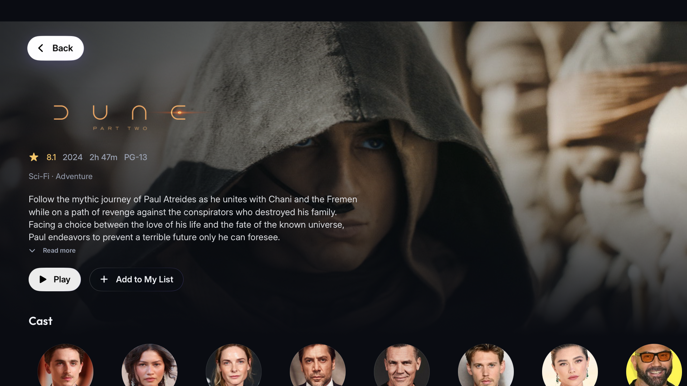

# Velvet for Apple TV

A native tvOS app with cinematic browsing, glass controls, and Siri Remote navigation. It shares Velvet's iOS data, synchronization, and playback engine; the interface is designed for television. Requires **tvOS 17 or later**. Apple TV 4K is the intended hardware.

This is the first Apple TV release. It is tested in the Apple TV simulator; physical Apple TV, receiver audio, HDR output, and provider DRM still need hardware verification. It does not include a public App Store listing or TestFlight invitation.

[](../../docs/screenshots/velvet-apple-tv-details.png)

*Actual Apple TV simulator capture. Runtime artwork belongs to its respective owners.*

## Features

- Home artwork, Continue Watching, My List, discovery rows, search, and profiles.
- Movie and series details with an expandable five-line description, seasons, episodes, watched state, cast, and related titles.
- Personal AI categories with ordered or shuffled playback, mixed movies/shows/episodes, automatic continuation, and deletion. Creation uses the backend's configured AI connection. Siri dictation and iPhone keyboard entry use the native tvOS text field where available.
- Movie/episode playback with resume, ±10-second seek, previous/play/next controls, source selection, audio tracks, subtitles, and autoplay. Back closes an open options panel; otherwise it leaves playback and saves your position.
- Block the current release group for a show or the exact release for a movie, then continue through another source. Blocks are stored on this device.
- Shared recovery, look-ahead heartbeats, and admin playback reporting. Repair remains best-effort; the client cannot guarantee seamless recovery of every incomplete release.
- A timeline Live TV guide with search, profile favorites, program information, and channel switching.
- A Live Sports catalog and native playback through the backend's existing sports bridge. See the requirements below.

## Build and run in Simulator

Install full Xcode with the tvOS SDK and a tvOS simulator runtime, plus [XcodeGen](https://github.com/yonaskolb/XcodeGen). From this directory:

```sh
export DEVELOPER_DIR=/Applications/Xcode.app/Contents/Developer
xcodegen generate
xcodebuild -project VelvetTV.xcodeproj -scheme VelvetTV \
  -destination 'generic/platform=tvOS Simulator' \
  -derivedDataPath build/DerivedData CODE_SIGNING_ALLOWED=NO build
open VelvetTV.xcodeproj
```

Choose an Apple TV 4K simulator and Run. If needed, install its runtime in Xcode's Components settings or run `xcodebuild -downloadPlatform tvOS`. The generated project and dependency resolution are checked in; regenerating requires XcodeGen. The repository defaults to unsigned builds and contains no signing team or credentials.

The tvOS target compiles shared files from `../ios/Velvet`, so keep both directories when cloning or copying the source. It uses the pinned VLCKitSPM 3.6.0 tvOS framework, not the iOS binary.

## Install on your Apple TV 4K

1. Put the Mac and Apple TV on the same local network. On Apple TV open **Settings → Remotes and Devices → Remote App and Devices**.
2. Pair the Apple TV in Xcode's Device Hub / Manage Devices (older Xcode: **Window → Devices and Simulators**), using the code shown on the television. [Apple's device instructions](https://developer.apple.com/documentation/xcode/building-and-running-an-app).
3. Open `VelvetTV.xcodeproj`. For the **VelvetTV** target, select your own development team and unique bundle identifier. In Build Settings enable **Code Signing Allowed** and **Code Signing Required**, set the signing identity to **Apple Development**, and enable automatic signing. Keep these changes local; regenerating the project restores the unsigned defaults.
4. Choose the paired Apple TV as the run destination and press Run. Follow any device-side developer prompts Xcode presents.
5. In Velvet's Settings enter your backend URL and optional access token, save, then choose your profile. Use a URL that the Apple TV can reach; `localhost` would refer to the Apple TV itself.

Simulator apps cannot be copied onto physical Apple TV. A physical installation needs its own signed build. For continued distribution to friends, use your own development/ad-hoc provisioning or TestFlight setup. Personal Team provisioning has short expiration periods and needs periodic rebuilding; see [Apple's account overview](https://developer.apple.com/help/account/basics/about-your-developer-account/).

## Backend and playback requirements

**Metadata and AI:** TMDB and AI credentials stay on your backend. The app has no built-in server address, API key, Spectrum session, or Codex login. Device-entered connection settings remain local preferences. Use HTTPS when connecting outside a trusted LAN.

**Admin reporting:** update the backend from this release to accept the `tvos` reporting platform. Older backends can still serve playback but reject Apple TV telemetry.

**Live TV:** uses the existing `/live/channels`, guide, tune, and revocable session APIs. Clear HLS plays with the native engine; protected channels use the shared AVPlayer/FairPlay path. Real provider FairPlay playback must be tested on physical hardware and requires an entitled, current provider session.

**Live Sports:** tvOS does not include the iOS embedded-web player. The app submits catalog event/source IDs to `/sports/tune`; the browser bridge configured under `[live_tv]` with `enabled=true` and `upstream_url` produces a native playback session. An existing sports catalog alone is not enough. The backend bridge has its own capacity/latency costs and must be configured separately; see [backend setup](../../backend/README.md). The app displays the backend's error when that bridge is unavailable.

**Video and audio:** the initial VLCKit VOD path conservatively excludes Dolby Vision-tagged releases, including ambiguous DV/HDR hybrids. It chooses HDR10/HLG only when the attached display reports those formats, otherwise SDR. HDR10+ releases can use their HDR10 base when supported. Dolby Vision passthrough and lossless Atmos bitstream output are not promised by this port. TrueHD/MLP can use the existing backend audio compatibility path. Test your actual TV/receiver combination before treating simulator playback as a compatibility guarantee.

**Platform differences:** Apple TV is not a Send to TV receiver in this first port. The existing phone-to-Shield handoff remains unchanged. tvOS does not replace its system Home screen with Velour. Top Shelf currently shows static Velvet branding.

## Tests

In separate terminals, start the generated-video recovery fixture and the synthetic UI catalog:

```sh
python3 ../ios/scripts/playback-recovery-fixture.py
python3 ../ios/scripts/audio-player-fixture.py
python3 scripts/ui-fixture.py
```

Then run the unit and remote-navigation UI tests on a named simulator:

```sh
xcodegen generate
xcodebuild test -project VelvetTV.xcodeproj -scheme VelvetTV \
  -destination 'platform=tvOS Simulator,name=Velvet Apple TV 4K' \
  -derivedDataPath build/DerivedData CODE_SIGNING_ALLOWED=NO
```

Use the simulator name available on your Mac. The fixture scripts require FFmpeg. Tests cover category order, episode grouping, recovery limits, metadata credential boundaries, movie release identity, native sports session validation, deep links, and actual remote focus/navigation. Native playback tests use generated H.264/AAC and TrueHD fixtures and skip if their fixture server is absent. UI tests require the fixture on port 18886. Only Debug builds accept the loopback-only `VELVET_UI_FIXTURE` launch environment; Release builds contain no test backend override.

## Assets and licensing

The layered tvOS app icon and Top Shelf assets use Velvet's existing vector mark. Regenerate them on macOS with `swift scripts/generate-brand.swift`. Outfit, Inter, and VLCKit retain their included license notices under the shared iOS resources. Runtime catalog artwork is not bundled. See the repository [license](../../LICENSE) before redistribution.
